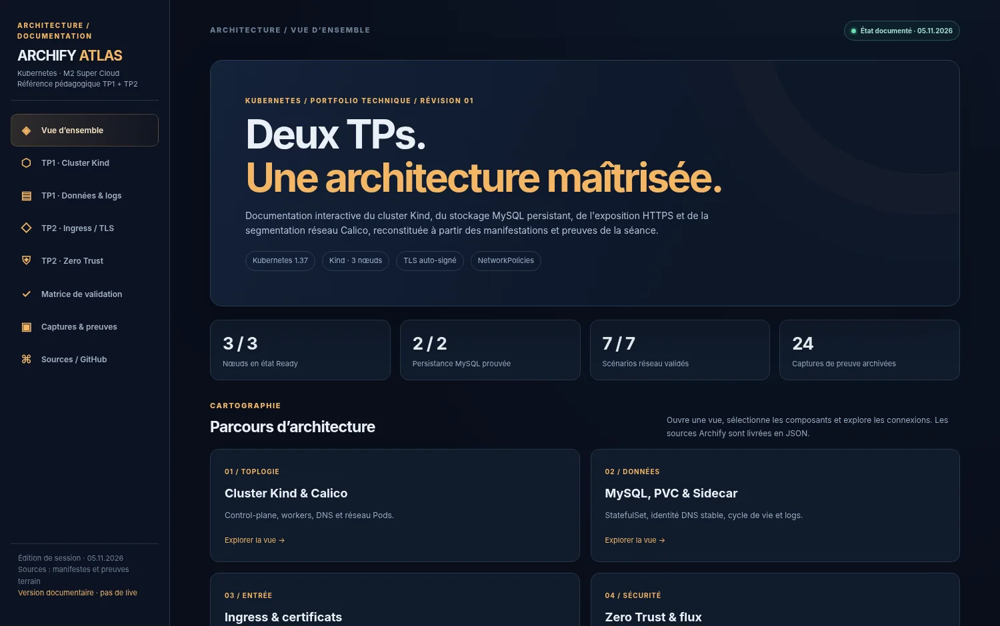
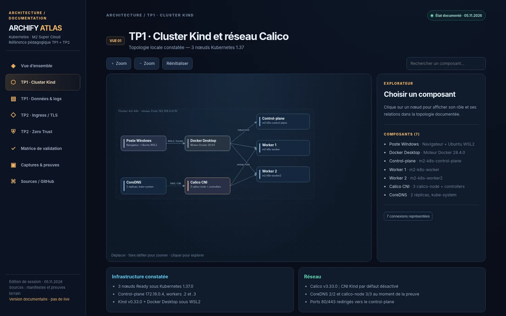
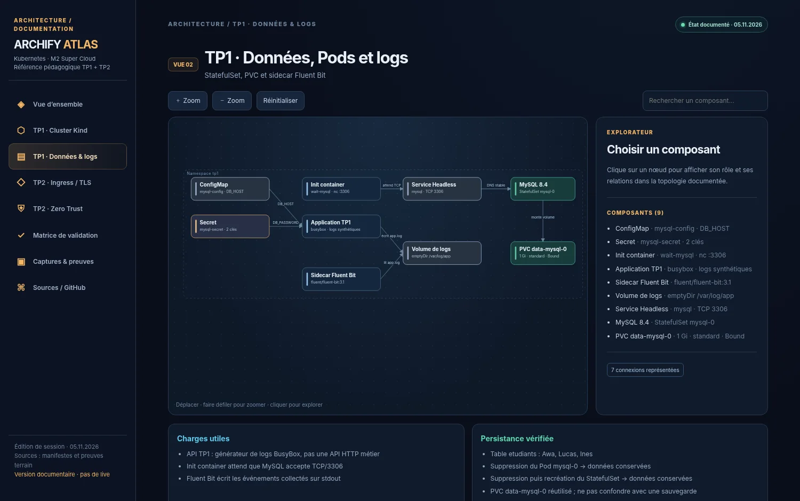
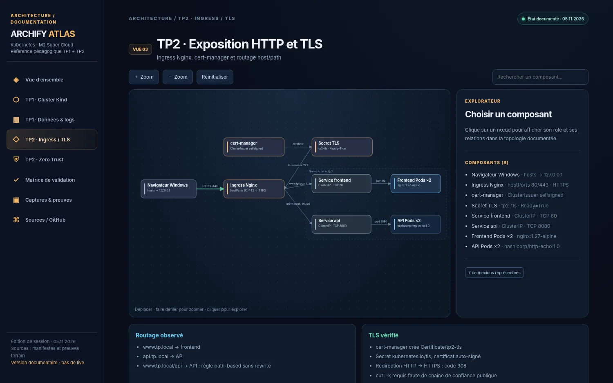
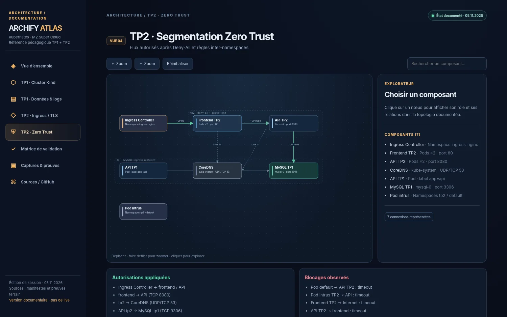
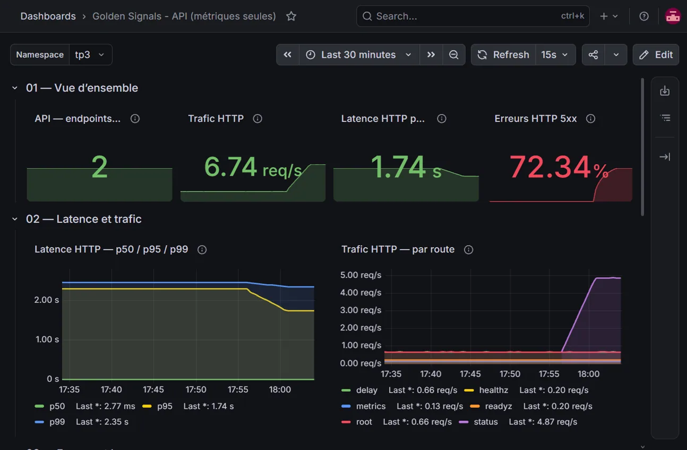
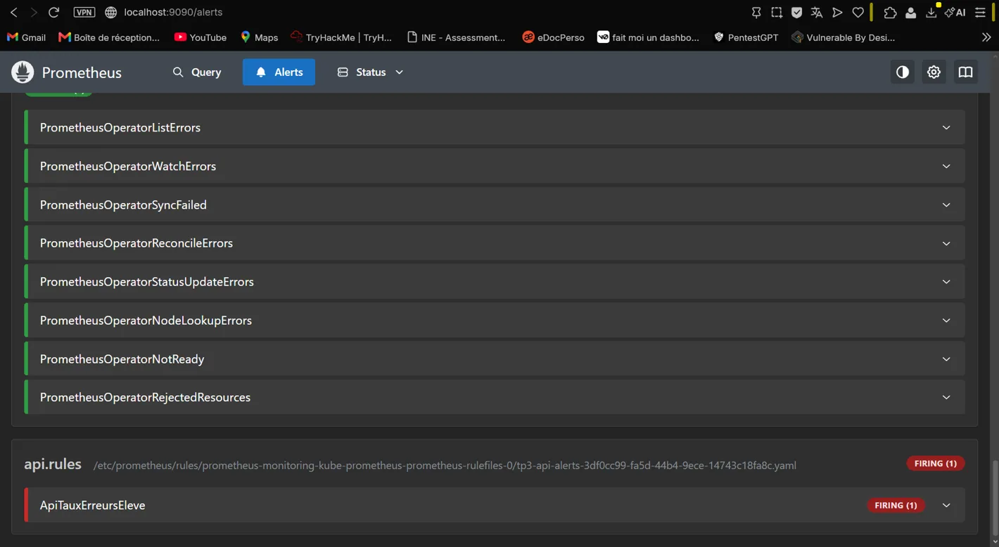

# Kubernetes — M2 Super Cloud

**Travaux pratiques d'administration, d'orchestration et de sécurisation d'applications avec Kubernetes.**  
Environnement local réalisé sous **Windows / Ubuntu WSL2 / Docker Desktop / Kind**, dans le cadre du cursus M2 Super Cloud.


[**Explorer la documentation interactive Archify Atlas**](https://krokmoo.github.io/k8s-m2/atlas/) · [**Consulter le TP1**](tp1/README.md) · [**Consulter le TP2**](tp2/README.md) · [**Consulter le TP3**](tp3/README.md) · [**Voir les preuves**](docs/atlas/assets/preuves/) · [**Sources d'architecture**](docs/atlas/sources/)

[](https://krokmoo.github.io/k8s-m2/atlas/)

> **Documentation interactive :** cliquez sur l'image pour ouvrir le portail Archify Atlas publié sur GitHub Pages. Le site propose des schémas explorables, une matrice de validation et une galerie de captures. Il s'agit d'une **reconstitution documentaire** de l'environnement testé, et non d'un accès en temps réel au cluster.

---

## Présentation du dépôt

Ce dépôt rassemble les **configurations Kubernetes**, les **résultats des expérimentations**, les **réponses aux questions des TP** et une **documentation visuelle** de l'infrastructure. Son objectif est de conserver des livrables reproductibles et vérifiables : les manifestes YAML montrent *ce qui a été configuré* ; les comptes rendus et captures montrent *ce qui a effectivement été observé*.

| Travail | Sujet | État | Livrables |
|:--|:--|:--|:--|
| **TP1** | Kind, Pods, Deployments, StatefulSet, Sidecar | **Terminé** | [Compte rendu](tp1/README.md) · [Manifestes et tests](tp1/) |
| **TP2** | Ingress, TLS, cert-manager, NetworkPolicies | **Terminé** | [Compte rendu](tp2/README.md) · [Manifestes et tests](tp2/) |
| **TP3** | Prometheus, Grafana, Loki, Fluent Bit, Alertmanager | **Terminé (tests observés)** | [Compte rendu + 11 réponses](tp3/README.md) · [Dashboard](tp3/golden-signals.json) · [Preuves](tp3/preuves/) |
| **TP4** | Application trois tiers, Helm, sécurité et CI/CD | **À réaliser** | Projet final à venir |

Les TP1, TP2 et TP3 ont été réalisés sur le **même cluster Kind `m2-k8s`**, conformément au déroulement du cours.

## Architecture en images

Les vues suivantes sont des **captures du portail interactif**, complétées par de véritables captures Grafana du TP3. Cliquez sur n'importe quelle image pour ouvrir l'Atlas et sélectionner la rubrique correspondante dans le menu latéral.

| TP1 — Cluster Kind et réseau Calico | TP1 — MySQL, stockage et logs |
|:--:|:--:|
| [](https://krokmoo.github.io/k8s-m2/atlas/) | [](https://krokmoo.github.io/k8s-m2/atlas/) |
| **TP2 — Ingress HTTP(S) et certificats TLS** | **TP2 — NetworkPolicies et Zero Trust** |
| [](https://krokmoo.github.io/k8s-m2/atlas/) | [](https://krokmoo.github.io/k8s-m2/atlas/) |

| TP3 — Dashboard Golden Signals pendant le chaos | TP3 — Alerte Prometheus FIRING |
|:--:|:--:|
| [](https://krokmoo.github.io/k8s-m2/atlas/) | [](https://krokmoo.github.io/k8s-m2/atlas/) |

**Portail complet (TP1, TP2 et TP3) :** [krokmoo.github.io/k8s-m2/atlas](https://krokmoo.github.io/k8s-m2/atlas/) — schémas navigables, détails des composants, tableaux de tests et captures de séance.

## Environnement technique

| Couche | Technologies et configuration |
|:--|:--|
| Poste de travail | Windows, Ubuntu WSL2, Docker Desktop (moteur Docker 28.4.0) |
| Orchestration | Kubernetes **v1.37.0** sous **Kind v0.33.0** |
| Topologie | **1 control-plane + 2 workers** |
| Réseau des Pods | **Calico** (CNI, NetworkPolicies), CoreDNS |
| Workloads TP1 | Nginx, Deployment / ReplicaSet, MySQL **8.4** en StatefulSet, Fluent Bit **3.1** |
| Stockage | PVC **1 Gi**, StorageClass `standard`, volume lié au StatefulSet |
| Exposition TP2 | Ingress Nginx, Services ClusterIP, routage par hôte et chemin |
| TLS | cert-manager, ClusterIssuer `selfsigned`, Secret `tp2-tls` |
| Sécurité réseau | Deny-All, exceptions DNS/Ingress/API, règles inter-namespaces TP1 ↔ TP2 |

> L'environnement est un **laboratoire local**. Les domaines `.local` et le certificat auto-signé servent uniquement aux exercices ; ce déploiement n'est pas présenté comme une plateforme de production.

## TP1 — Fondamentaux Kubernetes et persistance

Le premier TP construit le cluster et démontre le fonctionnement des principales ressources :

1. **Initialisation :** cluster Kind à trois nœuds, réseau Calico et contrôle des Pods système.
2. **Cycle de vie :** Pod Nginx isolé, puis Deployment supervisé par un ReplicaSet.
3. **Résilience :** passage de 3 à 5 réplicas, mise à jour défectueuse (`ImagePullBackOff`) et rollback réussi.
4. **Configuration :** ConfigMap et Secret injectés dans les conteneurs.
5. **Données :** MySQL en StatefulSet, Service Headless et PVC `data-mysql-0`.
6. **Journalisation :** application et sidecar Fluent Bit partageant un volume `emptyDir`.
7. **Persistance :** les trois enregistrements SQL ont été retrouvés après suppression du Pod puis après suppression/recréation du StatefulSet.

**Preuves principales :** [état final du namespace](tp1/etat-final.txt) · [nœuds opérationnels](tp1/nodes-ready.txt) · [rollback](tp1/deployment-rollback.txt) · [PVC après recréation](tp1/pvc-apres-recreation.txt) · [captures TP1](docs/atlas/assets/preuves/tp1/).

Le [README du TP1](tp1/README.md) regroupe les explications et les **10 réponses aux questions** du sujet.

## TP2 — HTTPS et isolation réseau

Le deuxième TP ajoute une couche d'exposition et de contrôle des communications :

1. **Ingress Nginx :** un contrôleur sur le control-plane Kind, accessible sur les ports 80/443.
2. **Services :** deux réplicas frontend et deux réplicas API ; DNS et endpoints vérifiés.
3. **Routage :** `www.tp.local` vers le frontend, `api.tp.local` et `www.tp.local/api` vers l'API.
4. **HTTPS :** certificat généré par cert-manager, stockage dans le Secret TLS, redirection HTTP **308** vers HTTPS.
5. **Zero Trust :** Deny-All, ouverture ciblée des flux nécessaires, tests positifs et négatifs.
6. **Inter-namespaces :** accès TCP **3306** autorisé depuis les API concernées vers MySQL ; test DNS et TCP effectué depuis un Pod API du TP2 (`code retour 0`).

### Matrice de validation réseau

| Test | Flux | Résultat constaté |
|:--:|:--|:--|
| 01 | HTTPS → frontend | **Autorisé** |
| 02 | HTTPS → API | **Autorisé** |
| 03 | Frontend → API (8080) | **Autorisé** |
| 04 | Pod du namespace `default` → API | **Bloqué** |
| 05 | Pod non autorisé dans `tp2` → API | **Bloqué** |
| 06 | Frontend → Internet | **Bloqué** |
| 07 | API → frontend | **Bloqué** |

**Preuves principales :** [Ingress HTTPS](tp2/ingress.yaml) · [négociation TLS](tp2/tls-test.txt) · [NetworkPolicies](tp2/) · [captures TP2](docs/atlas/assets/preuves/tp2/).

Le [README du TP2](tp2/README.md) regroupe le tableau des tests et les **8 réponses aux questions** du sujet.

## TP3 — Observabilité, logs et alertes

Le troisième TP ajoute une plateforme complète d'**observabilité** autour de l'API instrumentée `podinfo` : **kube-prometheus-stack**, **ServiceMonitor**, **Grafana**, **Loki monolithique**, **Fluent Bit en DaemonSet**, **PrometheusRule** et **Alertmanager**.

- **Cibles API :** 2/2 `UP`, metrics `/metrics` scrappées toutes les 15 secondes.
- **Montée en charge :** 1,86 → **7,17 requêtes/s** après passage de 1 à 5 générateurs (×3,85).
- **Latence p95 :** 2,29 s en configuration initiale et 2,34 s sous charge.
- **Logs :** Fluent Bit **3/3 nœuds** (tolérance control-plane), Loki avec PVC 2 Gio ; événements `ERROR` retrouvés via LogQL.
- **Incident :** simulation d'erreurs HTTP 500, **72,34 %** d'erreurs malgré **2/2 API UP** ; alerte `ApiTauxErreursEleve` en état **FIRING**, visible dans Alertmanager.

[Lire le compte rendu détaillé et les **11 réponses**](tp3/README.md) · [Importer le dashboard Grafana complet](tp3/golden-signals.json) · [Captures de preuve](tp3/preuves/) · [PromQL](tp3/promql.md) · [LogQL](tp3/logql.md) · [Explorer les vues TP3 dans Atlas](https://krokmoo.github.io/k8s-m2/atlas/)

> **Point important :** la documentation GitHub Pages affiche des diagrammes et captures statiques, pas la télémétrie en direct. Le dashboard Grafana devient interactif après import dans un Grafana connecté aux datasources Prometheus et Loki.

## Structure du dépôt

```text
k8s-m2/
├── README.md                   # Présentation et accès au portail
├── INSTALLATION.md             # Consulter et publier Archify Atlas
├── tp1/
│   ├── README.md               # Réponses, méthode et résultats du TP1
│   ├── kind-config.yaml
│   ├── mysql-config.yaml
│   ├── mysql.yaml
│   ├── api-sidecar.yaml
│   └── *.txt                   # Sorties des tests et preuves
├── tp2/
│   ├── README.md               # Réponses et matrice de tests TP2
│   ├── apps.yaml
│   ├── ingress.yaml
│   ├── issuer.yaml
│   ├── values-ingress.yaml
│   ├── np-*.yaml               # Règles réseau
│   └── *.txt                   # Tests HTTP et TLS
├── tp3/
│   ├── README.md               # Compte rendu et 11 réponses
│   ├── values-*.yaml           # Helm Monitoring, Loki, Fluent Bit
│   ├── api-tp3.yaml, chaos.yaml
│   ├── servicemonitor.yaml, alert-rules.yaml
│   ├── golden-signals.json     # Dashboard Grafana Prometheus + Loki
│   ├── promql.md, logql.md
│   └── preuves/                # 16 captures de TP3
└── docs/
    ├── index.html             # Accueil GitHub Pages → Atlas
    └── atlas/
        ├── index.html         # Portail interactif autonome
        ├── atlas-data.json
        ├── README.md
        ├── PROVENANCE.md
        ├── sources/            # 6 modèles d'architecture JSON
        └── assets/
            ├── readme/        # Aperçus intégrés à ce README
            └── preuves/       # Captures des TP1, TP2 et TP3
```

## Consulter les rendus

**Sans installer Kubernetes :** consultez [le portail Archify Atlas](https://krokmoo.github.io/k8s-m2/atlas/) ou les [README de TP1](tp1/README.md) [TP2](tp2/README.md) et [TP3](tp3/README.md). Tous les fichiers nécessaires à la lecture sont présents dans ce dépôt.

**En local :** pour servir le site depuis le dossier du dépôt :

```bash
cd ~/k8s-m2
python3 -m http.server 8765
# Ouvrir http://localhost:8765/docs/atlas/
```

Le portail fonctionne comme une documentation statique : il ne dépend pas de la disponibilité du cluster Kind. La procédure détaillée figure dans [INSTALLATION.md](INSTALLATION.md).

<details>
<summary><strong>Commandes utiles pour inspecter le cluster existant</strong></summary>

```bash
kubectl config use-context kind-m2-k8s
kubectl get nodes -o wide
kubectl get all,pvc -n tp1
kubectl get pods,svc,ingress,networkpolicy -n tp2
kubectl get certificate -n tp2
kubectl get pods,svc,servicemonitor,prometheusrule -n tp3
kubectl get pods,daemonset,pvc -n monitoring
```

Ces commandes nécessitent un cluster local déjà configuré ; elles ne fonctionnent pas à distance depuis GitHub Pages.

</details>

## À propos d'Archify Atlas

La documentation interactive est un **portail HTML autonome** élaboré à partir des manifestes, des énoncés et des preuves de séance des trois TP. Les fichiers `docs/atlas/sources/*.architecture.json` sont des sources d'architecture destinées au moteur [Archify](https://github.com/tt-a1i/archify). **Le portail actuel n'est pas un export natif produit et validé par le moteur Archify** : les sources JSON devront être validées et rendues avec celui-ci pour générer des sorties natives. Les captures montrent les états **documentés des 5 et 6 novembre 2026**, pas une télémétrie en direct.

## Auteur et suite des travaux

**Dylan Cailleau** · [GitHub @KroKmOO](https://github.com/KroKmOO)  
**Prochaine étape :** TP4 (projet final Helm / CI-CD).

---

**Accès rapide :** [Documentation interactive](https://krokmoo.github.io/k8s-m2/atlas/) · [TP1](tp1/README.md) · [TP2](tp2/README.md) · [TP3](tp3/README.md) · [Preuves](docs/atlas/assets/preuves/)
