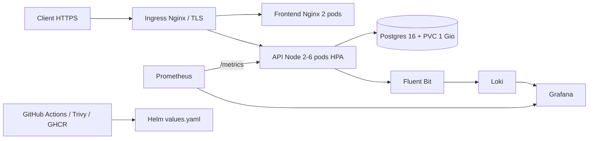

# TP4 — Inventaire, projet final Kubernetes (/20)

> **État au 06/11/2026** : déploiement Helm, HTTPS, persistance PostgreSQL, RBAC, logs Loki et rollback observés. HPA > 2 réplicas, alerte TP4, tests NetworkPolicies et CI GitHub Actions restent à valider.

Application trois tiers de la séance « Projet final noté /20 » : Nginx non privilégié (2 réplicas), API Node/Express (HPA 2–6), PostgreSQL 16 (StatefulSet + PVC 1 Gio). HTTPS `inventaire.local` via ingress-nginx/cert-manager. Conçue pour le cluster Kind `m2-k8s` existant et la supervision des TP1–TP3.

## Démarrage rapide (sur le cluster existant)

Depuis `~/k8s-m2/projet/` :

```bash
bash scripts/00-preflight.sh
bash scripts/01-deployer.sh
bash scripts/02-tester-https.sh
```

**Étape Windows obligatoire pour le navigateur** : ouvrir le fichier `C:\Windows\System32\drivers\etc\hosts` en administrateur et ajouter `127.0.0.1 inventaire.local`. Sinon, les scripts `curl --resolve` fonctionnent quand même.

Le mot de passe PostgreSQL est généré aléatoirement dans un Secret Kubernetes `inventaire-postgres-auth`, jamais enregistré dans Git. Ne supprimez pas ce Secret tant que la base existante l'utilise.

## Architecture cible

[Diagramme d’architecture (source Mermaid)](architecture/architecture.mmd)

Le diagramme Mermaid source est dans [`architecture/architecture.mmd`](architecture/architecture.mmd) ; GitHub affiche plus facilement les Mermaid intégrés dans un bloc `mermaid` dans ce document :



## Prérequis déjà installés

- Cluster `kind-m2-k8s` (3 nœuds) + Calico ; `kubectl`, `helm`, `kind`, `docker`.
- ingress-nginx avec les ports hôtes 80/443, cert-manager et un ClusterIssuer `selfsigned`.
- Prometheus Operator/Prometheus, Grafana, Loki et Fluent Bit des TP2/TP3.
- `metrics-server` est installé ou mis à jour dans `scripts/01-deployer.sh` (sur Kind : `--kubelet-insecure-tls`, **uniquement pour le laboratoire**).

## Choix techniques et sécurité

- `helm upgrade --install inventaire ./chart/inventaire -n inventaire --create-namespace` après création du namespace avec PSS `restricted`.
- Chart paramétrable : images/tags, réplicas, ressources, host TLS, taille du stockage, seuils HPA.
- PostgreSQL : Service Headless, StatefulSet, `volumeClaimTemplates`, `PGDATA` en sous-répertoire, PVC `ReadWriteOnce`.
- API : `ServiceAccount` dédié sans montage du token Kubernetes, ConfigMap pour DB_HOST/PORT/NAME/USER ; `DB_PASSWORD` uniquement par `secretKeyRef`.
- Probes de disponibilité et de vie ; conteneurs non-root, seccomp RuntimeDefault, capacités supprimées, rootFS en lecture seule et `emptyDir` pour répertoires transitoires.
- NetworkPolicies `default deny` + DNS + ingress-nginx → frontend/API + API → PostgreSQL + Prometheus → API. Ne pas exposer `/metrics` via l'Ingress ; seul `/api` part à l'API.
- Un compte `lecteur` RBAC peut lire Pods/Services/ConfigMaps, pas supprimer ni lire les Secrets.
- TLS de laboratoire auto-signé, donc alerte navigateur normale ; **pas un certificat de production**.

## Tests reproductibles et captures

Voir la [checklist des captures](captures/README.md).

```bash
bash scripts/03-persistance.sh
bash scripts/04-securite-reseau.sh
bash scripts/05-charge-hpa.sh
bash scripts/06-rollback.sh
bash scripts/07-etat-final.sh
```

**Attention :** `03-persistance.sh` supprime et recrée **uniquement le Pod PostgreSQL** en conservant son PVC. L'article ajouté est vérifié avant et après.

La charge CPU appelle `GET /api/cpu?ms=200` en HTTPS depuis WSL (les NetworkPolicies interdisent le trafic direct d'un Pod de test non autorisé). HPA CPU cible 60 %, min 2, max 6. Le temps de stabilisation peut varier.

## Observabilité

- `ServiceMonitor inventaire-api` : API `/metrics:3000` toutes les 15s, cible attendue **2 endpoints UP** dans Prometheus.
- Dashboard importable : [`grafana/golden-signals-inventaire.json`](grafana/golden-signals-inventaire.json). Sources nécessaires : Prometheus et Loki, connectées dans Grafana. Si le nom/UID diffère, choisir les sources lors de l'importation.
- PrometheusRule : `InventaireApiLatenceElevee`, p95 > 180ms pendant 1 min ; déclenchement visé pendant `05-charge-hpa.sh`. La réussite n'est validée qu'après affichage Firing.
- Loki : `{namespace="inventaire"} |= "/api/cpu"` ; les lignes JSON de l'API sont collectées par Fluent Bit.

## CI/CD / GitOps

Workflow **à la racine du dépôt** : `.github/workflows/ci.yaml` ; déclenchement sur push vers `main` modifiant `projet/app/**` (ou lancement manuel), build Docker, scan Trivy `CRITICAL` bloquant, push vers `ghcr.io/krokmoo/inventaire-api:<sha>`, commit automatique du nouveau tag dans `projet/chart/inventaire/values.yaml`.

Le commit du bot ne crée **pas de boucle** : il modifie `values.yaml` (hors `projet/app/**`) et les commits utilisant `GITHUB_TOKEN` ne déclenchent généralement pas de nouveau workflow `push`.

### Deux modes de déploiement

1. **Avant CI** : `scripts/01-deployer.sh` construit et charge `inventaire-api:dev` dans Kind, puis surcharge temporairement `api.image.repository` et `api.image.tag` via Helm. Aucun registry nécessaire.
2. **Après CI réussie** : rendre le package GHCR **public** (ou configurer un `imagePullSecret`), puis déployer l'image référencée dans `values.yaml` :
   `helm upgrade --install inventaire ./chart/inventaire -n inventaire --wait --timeout 12m`.

La seconde voie doit être démontrée seulement après succès de GitHub Actions et disponibilité de l'image GHCR.

## Réponses courtes et difficultés

- `Helm rollback` revient à une révision antérieure des ressources déclaratives, sans effacer le PVC PostgreSQL.
- `Pod Security restricted` impose UID non-root, seccomp, absence d'élévation et capacités Linux supprimées ; un namespace étiqueté `restricted` fait respecter ces règles.
- Les NetworkPolicies Calico filtrent les communications inter-Pods ; le Pod `intrus` démontre le blocage vers PostgreSQL.
- `ServiceMonitor` découvre les endpoints et `PrometheusRule` définit l'alerte ; l'état des cibles et le déclenchement doivent être photographiés.
- Le HPA utilise les métriques CPU servies par metrics-server et se base sur les **requests CPU**.
- Les réplicas de l'API peuvent monter/descendre indépendamment de PostgreSQL, qui reste une instance avec stockage persistant.
- Les commits du workflow GitHub sont faits avec `GITHUB_TOKEN` et mis à jour dans la branche, sans nouveau déclenchement en boucle.

## Démo de 10 minutes

1. `helm status`, puis `kubectl -n inventaire get all,pvc,ingress,hpa,networkpolicy`.
2. Navigateur HTTPS, ajout d'un article.
3. Supprimer `inventaire-postgres-0`, confirmer la persistance de l'article.
4. Preuve NetworkPolicy + vérification RBAC.
5. Faire monter le HPA sous `/api/cpu`, observer les réplicas.
6. Règle Prometheus Firing, logs Loki.
7. GitHub Actions : build, scan Trivy, GHCR, tag GitOps et déploiement depuis le dépôt.

## Limites

Ce rendu est un **laboratoire Kind**, pas une vraie production : certificat auto-signé, un seul PostgreSQL, stockage local, Node.js 20 fourni dans le sujet, ressources dimensionnées pour WSL. Les résultats des tests doivent être inscrits après exécution et non annoncés comme acquis d'avance.

[**Voir les validations terrain et les 9 preuves du TP4**](VALIDATIONS_TERRAIN.md).
