# TP1 — Kind, Pods, StatefulSet et Sidecar

**Kubernetes M2 Super Cloud — Compte rendu du TP1 (5 novembre 2026)**

## 1. Objectif et environnement

L'objectif est de construire un cluster Kubernetes local de **trois nœuds**, puis de manipuler les Pods et Deployments, mettre en service une base MySQL persistante avec un StatefulSet et collecter les logs d'une application par un sidecar Fluent Bit.

Environnement effectivement utilisé : Windows et Ubuntu sous WSL2 avec Docker Desktop ; Docker `28.4.0`, Kind `v0.33.0`, kubectl `v1.37.2`, Helm `v3.22.1` et Git `2.53.0`. Le cluster `m2-k8s` comporte un control-plane et deux workers sous Kubernetes `v1.37.0`. Namespace applicatif : `tp1`.

**Écart documenté par rapport au sujet :** la procédure exécutée a utilisé le manifeste Calico `v3.33.0` à la place de `v3.28.2`, pour correspondre à la version de Kubernetes installée par Kind. Le CNI par défaut de Kind est désactivé, et les ports 80/443 sont mappés sur le control-plane.

## 2. Cluster Kind et réseau Calico

Le cluster a d'abord affiché trois nœuds `NotReady`, avant le déploiement de Calico. Après installation, les trois nœuds (`m2-k8s-control-plane`, `m2-k8s-worker`, `m2-k8s-worker2`) sont passés à `Ready`. Les composants du namespace `kube-system` fonctionnaient tous au moment de la vérification : notamment les trois Pods `calico-node`, deux Pods CoreDNS et les composants du control-plane.

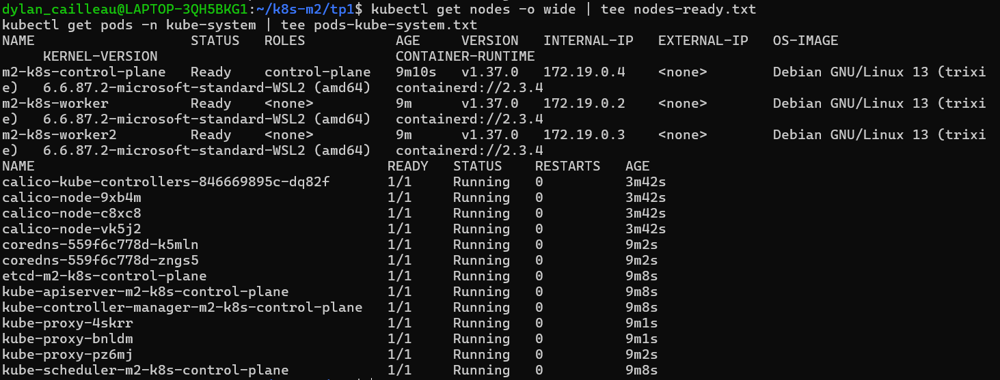

### Question 1 — Associer les Pods de `kube-system` aux composants Kubernetes

| Pods observés | Composant | Rôle |
|---|---|---|
| `kube-apiserver-m2-k8s-control-plane` | API Server | Reçoit les demandes d'administration et expose l'API Kubernetes. |
| `etcd-m2-k8s-control-plane` | etcd | Conserve l'état et les données de configuration du cluster. |
| `kube-scheduler-m2-k8s-control-plane` | Scheduler | Sélectionne les nœuds sur lesquels exécuter les Pods en attente. |
| `kube-controller-manager-m2-k8s-control-plane` | Controller Manager | Maintient l'état réel conforme à l'état souhaité. |
| `kube-proxy` ×3 | kube-proxy | Configure le chemin réseau des Services Kubernetes sur les nœuds. |
| `calico-node` ×3 et `calico-kube-controllers` | CNI Calico | Assure le réseau des Pods et la gestion des politiques de réseau. |
| `coredns` ×2 | DNS | Résout les noms internes des Services et Pods. |

### Question 2 — Pourquoi les nœuds étaient-ils `NotReady` avant Calico ?

La configuration Kind déclare `disableDefaultCNI: true`. Sans plugin CNI, Kubernetes ne peut pas configurer correctement le réseau des Pods. Le kubelet signale donc une indisponibilité réseau, et le nœud reste `NotReady`. Après installation de Calico, le réseau des Pods devient opérationnel et les trois nœuds passent à `Ready`.

## 3. Pod Nginx isolé

Un Pod autonome `hello` a été créé avec l'image `nginx:1.27-alpine`. Il a démarré sur le worker `m2-k8s-worker`, avec l'adresse IP `192.168.231.129`. Le test `wget` depuis le conteneur a renvoyé du HTML et `kubectl port-forward pod/hello 8080:80` a permis d'afficher la page Nginx depuis le navigateur Windows.

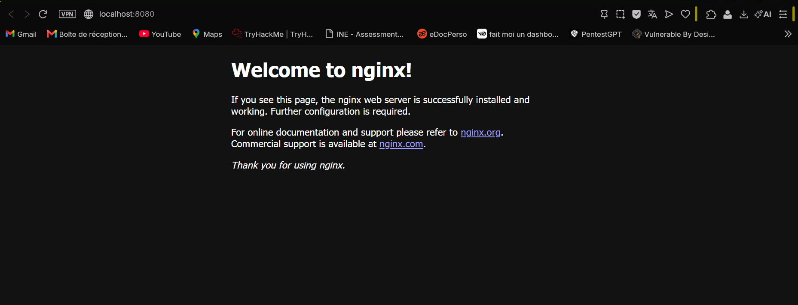

Après suppression (`kubectl delete pod hello`), l'instruction `kubectl get pods` indiquait « No resources found in tp1 namespace ».

### Question 3 — Le Pod a-t-il été recréé ? Pourquoi ?

Non. Il s'agissait d'un Pod créé directement avec `kubectl run`, sans contrôleur Deployment ou ReplicaSet chargé de maintenir des réplicas. Sa suppression est donc définitive jusqu'à nouvelle création explicite.

## 4. Deployment, montée en charge et rollback

Un Deployment `web` a été créé avec trois réplicas, puis porté à cinq. Une mise à jour vers `nginx:1.27-alpine` a été effectuée, suivie d'un déploiement volontairement erroné vers `nginx:9.99-inexistante`. Les captures montrent quatre anciens Pods `Running` et trois nouveaux Pods en `ErrImagePull`/`ImagePullBackOff`. Le `kubectl rollout undo` a ensuite ramené le Deployment à **cinq Pods disponibles sur cinq**.

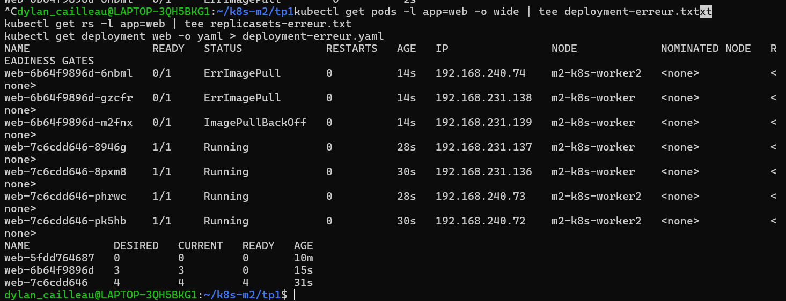

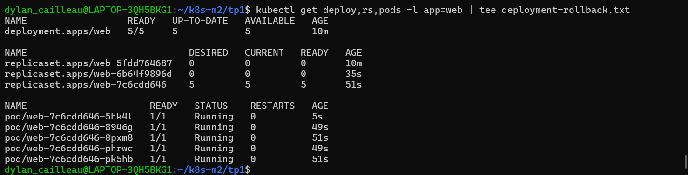

### Question 4 — Combien d'anciens Pods restent disponibles ? Quels paramètres expliquent ce résultat ?

**Quatre anciens Pods étaient disponibles** lors de l'échec. Avec cinq réplicas, la stratégie `RollingUpdate` utilise par défaut `maxUnavailable: 25 %` (un Pod indisponible au maximum, arrondi à l'inférieur) et `maxSurge: 25 %` (deux Pods supplémentaires au maximum, arrondi au supérieur). Kubernetes ne peut pas rendre disponibles les trois nouveaux Pods, car l'image est introuvable ; il conserve les quatre anciens Pods prêts et respecte sa contrainte de disponibilité.

### Question 5 — Combien de ReplicaSets existent après les manipulations, et pourquoi ?

**Trois ReplicaSets** ont été observés après rollback :

| ReplicaSet | `DESIRED` après rollback | Interprétation |
|---|---:|---|
| `web-5fdd764687` | 0 | Révision Nginx initiale. |
| `web-7c6cdd646` | 5 | Version saine restaurée. |
| `web-6b64f9896d` | 0 | Révision défectueuse (image inexistante). |

Les ReplicaSets de révisions précédentes peuvent rester présents, même à zéro réplica, pour documenter l'historique et rendre possible un rollback. Le Deployment de démonstration a ensuite été supprimé pour libérer les ressources.

## 5. ConfigMap et Secret MySQL

La ConfigMap `mysql-config` a été créée avec `MYSQL_DATABASE=appdb` et `MYSQL_USER=app`, puis enrichie de `DB_HOST=mysql-0.mysql.tp1.svc.cluster.local`. Le Secret `mysql-secret` de type `Opaque` contient les clés `MYSQL_ROOT_PASSWORD` et `MYSQL_PASSWORD`. Les mots de passe ont été saisis interactivement, sans être inscrits dans les manifestes du dépôt.

### Question 6 — Le Secret est-il chiffré ? Que faut-il en production ?

**Le Base64 n'est pas un chiffrement.** Par défaut, Kubernetes stocke les valeurs d'un Secret sous forme encodée et ne garantit pas systématiquement leur chiffrement au repos dans etcd. En production, il faut activer le chiffrement des données sensibles au repos, limiter les accès aux Secrets avec RBAC, sécuriser les sauvegardes d'etcd, gérer la rotation des identifiants et, selon le contexte, intégrer un coffre de secrets externe. Aucun mot de passe n'a été ajouté au présent dossier.

## 6. MySQL en StatefulSet et stockage persistant

Un Service Headless `mysql` (`clusterIP: None`) a été créé sur le port TCP 3306, avec un StatefulSet `mysql` d'un réplica exécutant l'image `mysql:8.4`. Le Pod `mysql-0` est devenu `1/1 Running`. Le PVC `data-mysql-0` de **1 Gio**, en accès `ReadWriteOnce` et classe `standard`, est passé à l'état `Bound`.

La table SQL `etudiants` a été créée, puis trois lignes ont été insérées : `Awa`, `Lucas`, `Ines`. Le premier `SELECT * FROM etudiants;` les a toutes retournées.

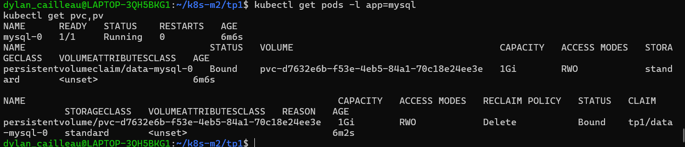

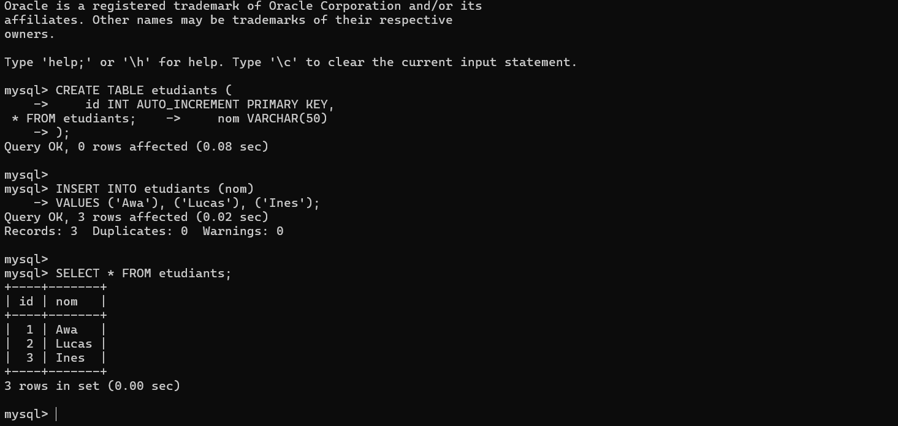

### Question 7 — Quel nom DNS complet résout `mysql-0.mysql` ? Pourquoi pas avec un Service ClusterIP ?

Le nom complet est **`mysql-0.mysql.tp1.svc.cluster.local`**. L'identité stable du Pod (`mysql-0`) et le Service Headless (`mysql`) permettent une résolution DNS propre au Pod. Un Service ClusterIP classique dispose principalement d'un nom de Service pointant vers une IP virtuelle commune, sans fournir de la même manière cette adresse DNS stable par Pod.

### Question 8 — Quel est le nom du PVC, et d'où vient-il ?

Le PVC se nomme **`data-mysql-0`**. Il est créé automatiquement grâce à `volumeClaimTemplates` dans le StatefulSet. Le nom associe le template `data`, le StatefulSet `mysql` et l'ordinal `0` du Pod.

## 7. Init container et sidecar Fluent Bit

Le Deployment `api` exécute un init container `wait-mysql` qui attend l'ouverture du port TCP 3306 sur `mysql-0.mysql`, puis deux conteneurs : un générateur de logs (`api`) et un collecteur (`fluent-bit`). Ils partagent un volume `emptyDir` monté sur `/var/log/app`. Le sidecar lit le fichier `app.log` et transmet sur sa sortie standard les enregistrements au format JSON. Le Pod observé était `2/2 Running` avec zéro redémarrage, et les logs progressaient régulièrement (`requete 55` à `requete 64` dans la capture).

Les variables `DB_HOST` et `DB_PASSWORD` ont également été injectées dans le conteneur `api` avec `valueFrom.configMapKeyRef` et `valueFrom.secretKeyRef`. La vérification a affiché le nom DNS de la base et confirmé la présence du mot de passe **sans le révéler**.

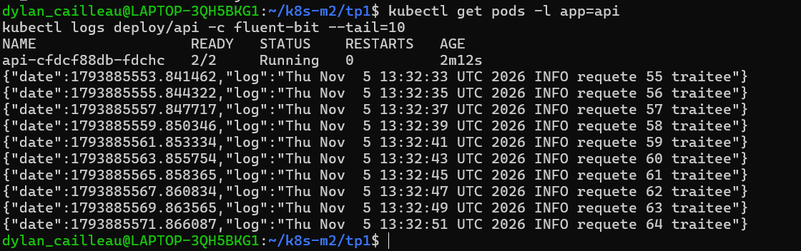

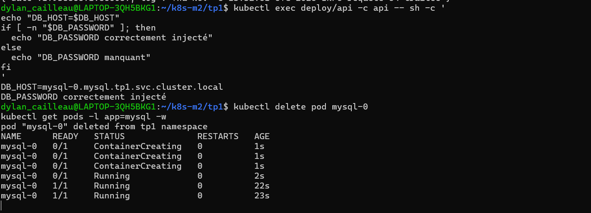

### Question 9 — Pourquoi ne pas exécuter MySQL dans le même Pod que l'application ?

La base et l'application ont des cycles de vie et des contraintes différentes. Les séparer permet de les mettre à jour, redémarrer et dimensionner indépendamment. Le StatefulSet garantit à MySQL une identité stable ainsi qu'un volume durable, tandis que le Deployment convient à la gestion des réplicas d'une application. Cela réduit le couplage entre une application remplaçable et les données qu'elle doit conserver.

## 8. Vérification de la persistance

**Test 1 — suppression du Pod.** `kubectl delete pod mysql-0` a entraîné la recréation automatique du même Pod par le StatefulSet. Après son retour à `1/1 Running`, la requête `SELECT * FROM etudiants;` a encore retourné `Awa`, `Lucas` et `Ines`. Le PVC `data-mysql-0` était toujours `Bound` et conservait le même identifiant de volume.

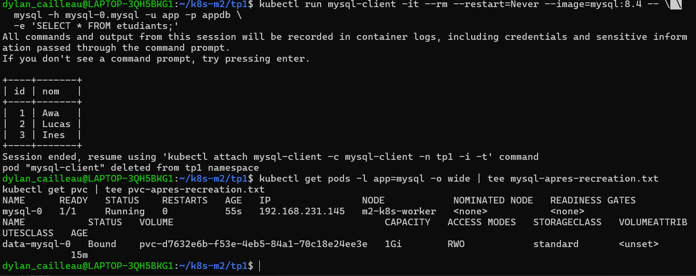

**Test 2 — suppression du StatefulSet.** Le StatefulSet a été supprimé avec `kubectl delete statefulset mysql`, tandis que le PVC est resté `Bound`. Après recréation du StatefulSet avec `kubectl apply -f mysql.yaml`, le `SELECT` a de nouveau retourné les trois enregistrements.

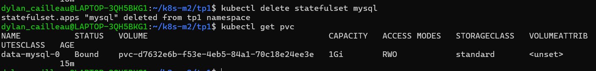

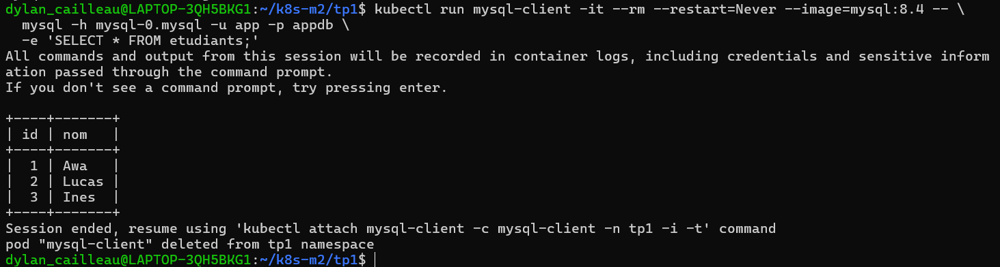

### Question 10 — Les données ont-elles survécu à la suppression du StatefulSet ? Que devient le PVC ?

**Oui : les trois enregistrements ont survécu.** Le PVC `data-mysql-0` a été conservé lors de la suppression du StatefulSet (comportement par défaut observé ici). À la recréation, le nouveau Pod `mysql-0` a réutilisé le même volume et a retrouvé la table `etudiants`. La conservation du PVC ne signifie pas une sauvegarde : sa suppression aurait d'autres conséquences selon la politique de rétention du volume.

## 9. État final et éléments remis

L'état final affichait le Pod `api` à `2/2 Running`, le Pod `mysql-0` à `1/1 Running`, le Deployment `api` à `1/1`, le StatefulSet `mysql` à `1/1` et le PVC `data-mysql-0` en état `Bound`.

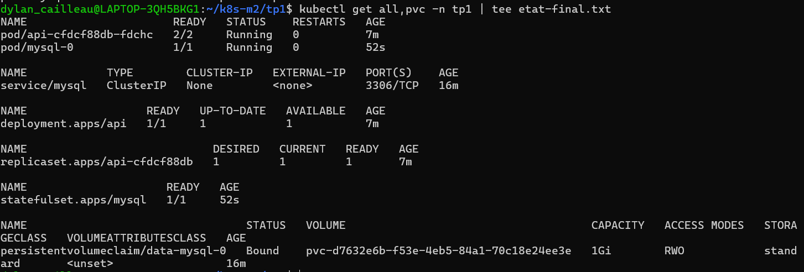

Fichiers du présent dossier :

- `kind-config.yaml` — configuration du cluster Kind.
- `mysql-config.yaml` — paramètres applicatifs non sensibles.
- `mysql.yaml` — Service Headless et StatefulSet MySQL avec stockage persistant.
- `api-sidecar.yaml` — ConfigMap Fluent Bit, init container, Deployment et variables d'environnement.
- `etat-final.txt` — **transcription** de la sortie visible dans la capture finale. Le fichier `etat-final.txt` original, déjà enregistré dans `~/k8s-m2/tp1/` sur le poste, doit remplacer cette transcription pour le dépôt remis.
- `preuves/` — douze captures de commandes et résultats réels.

**Sécurité :** le Secret `mysql-secret` a été créé dans le cluster, mais son contenu n'est volontairement pas fourni dans le dépôt. Les captures ne présentent pas les mots de passe.

**Conclusion :** le cluster local est opérationnel, les Pods sont supervisés par les contrôleurs appropriés, la mise à jour défectueuse est récupérable, Fluent Bit collecte des journaux et le stockage MySQL survit à la suppression du Pod puis du StatefulSet. Le cluster `m2-k8s` est conservé pour le TP2.
