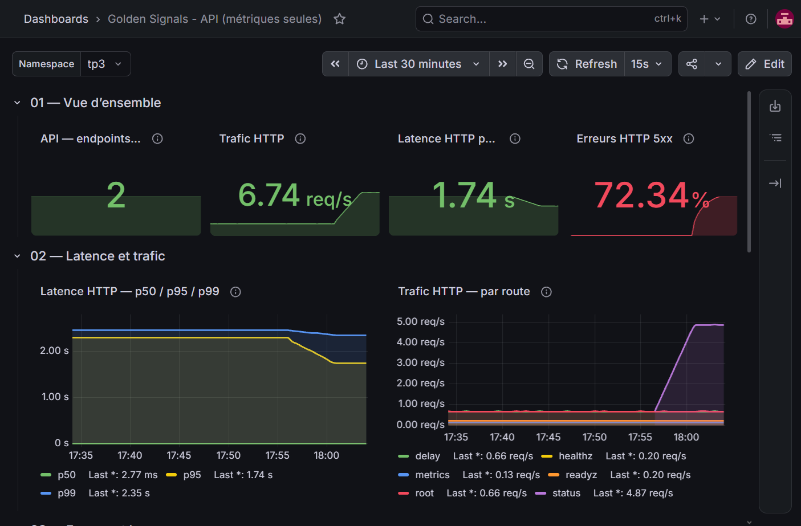
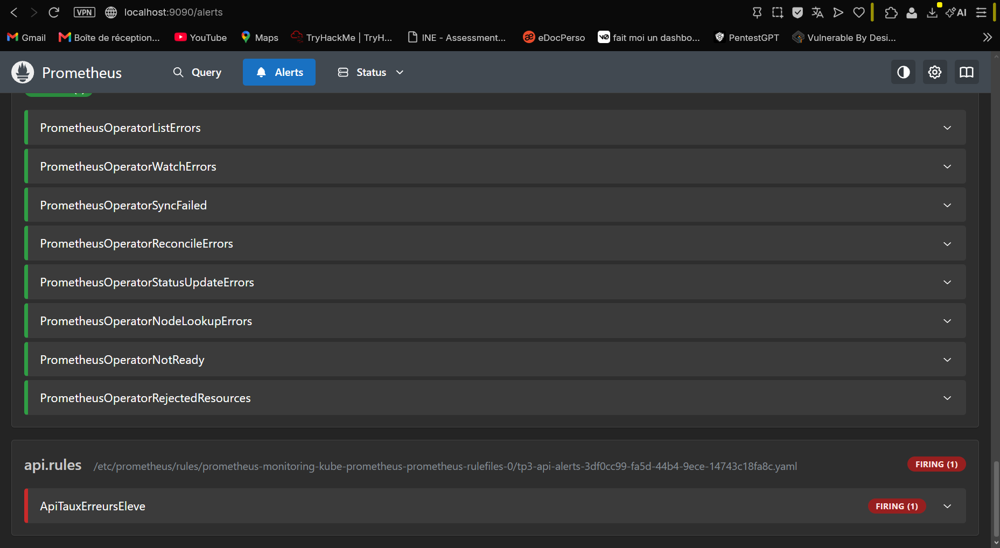

# TP3 — Supervision Kubernetes : Prometheus, Grafana et Loki

**Mastère M2 Super Cloud · Compte rendu de travaux pratiques**  
**Date de séance :** 6 novembre 2026  
**Dépôt :** [KroKmOO/k8s-m2](https://github.com/KroKmOO/k8s-m2) · [Archify Atlas](https://krokmoo.github.io/k8s-m2/atlas/)  
**Statut :** collecte métriques et logs validée ; montée en charge réalisée ; alerte Prometheus déclenchée et reçue par Alertmanager. Retour automatique à l'état `Inactive` après arrêt de `chaos` : à confirmer si une preuve supplémentaire est souhaitée.

## 1. Objectif et périmètre

Mettre en place une observabilité de bout en bout d'une application conteneurisée : **collecte des métriques** avec Prometheus et un `ServiceMonitor`, **visualisation** dans Grafana, **centralisation des logs** via Fluent Bit/Loki, **simulation d'incident** HTTP 500 et **règle d'alerte** réellement déclenchée. Le TP utilise un namespace isolé `tp3` et deux instances de l'API instrumentée `podinfo`.

Le même cluster **Kind `m2-k8s`**, composé d'un control-plane et de deux workers sous Kubernetes `v1.37.0`, est réutilisé depuis les TP1 et TP2. Aucun namespace préexistant n'a été détruit.

## 2. Architecture de la solution

```text
Windows / Ubuntu WSL2 — cluster Kind m2-k8s (3 nœuds)
                    │
       Namespace tp3 │                              Namespace monitoring
                    │
  trafic (BusyBox) ──┤
     1 → 5 Pods      ├──► Service api:9898 ──► podinfo ×2 ──► /metrics
                    │                                 ▲              │
  chaos (BusyBox) ───┘                            ServiceMonitor      │ scrape 15 s
  route /status/500                               namespace tp3       ▼
                                                          Prometheus ──► Alertmanager
                                                             │                 ▲
  Logs stdout de tous les Pods ──► Fluent Bit (DaemonSet 3/3) │                 │
                                      │                       ├─► Grafana ◄──────┘
                                      ▼                       │      ▲
                                    Loki :3100 ───────────────┘      │
                                    PVC 2 Gi                 Datasources
```

Les flux de logs et de métriques sont indépendants : Fluent Bit capture les logs des conteneurs et les envoie à Loki ; Prometheus interroge `/metrics` et évalue les règles d'alerte ; Grafana visualise les deux sources.

## 3. Déploiement et méthode

| Étape | Composants | Contrôles effectués |
|---|---|---|
| 1 | `kube-prometheus-stack` dans `monitoring` | Grafana `3/3`, Prometheus `2/2`, Alertmanager `2/2`, Operator, kube-state-metrics et Node Exporter `3/3` opérationnels. Après une première tentative Helm interrompue (`context canceled`), les Pods ont démarré. |
| 2 | `podinfo:6.7.1` ×2 + `trafic` | Trois Pods initialement `Running`, API `/metrics` accessible par port-forward `9898`. |
| 3 | `ServiceMonitor` | Cible `serviceMonitor/tp3/api/0` : **2 endpoints `UP`**, confirmés avec `up{namespace="tp3",service="api"}`. |
| 4 | PromQL | Graphiques CPU, mémoire, débit HTTP, latence p95 et taux 5xx interrogés dans Prometheus. |
| 5 | Grafana | Dashboards publics **15757 Global** et **15760 Pods** importés, dashboard **Golden Signals – API** configuré. |
| 6 | Loki monolithique + Fluent Bit | Pod Loki `2/2 Running`, Service TCP 3100, PVC `storage-loki-0` de 2 Gio `Bound` ; Fluent Bit déployé en DaemonSet sur les **3 nœuds** après ajout de tolérances au control-plane. |
| 7 | LogQL | Message `TP3_LOKI_TEST` retrouvé dans Grafana puis événements `ERROR` du générateur `chaos` retrouvés. |
| 8 | `PrometheusRule` + `chaos` | Taux d'erreurs de **72,34 %**, règle `ApiTauxErreursEleve` en **FIRING**, alerte reçue par Alertmanager. |

### Incidents de mise en œuvre et correctifs

**Helm monitoring :** première installation interrompue (`context canceled`) durant le téléchargement des images ; les conteneurs ont ensuite démarré, vérifiés dans Kubernetes. **Port-forward :** conflits sur le port Grafana `3000` dus à un tunnel encore présent ; tunnel opérationnel sur `3001`. **Chart Loki :** le schéma du chart `grafana-community/loki` rejetait la propriété `minio` ; la clé a été retirée et la configuration a ensuite été déployée. **Fluent Bit :** initialement 2/2 sur les workers, puis 3/3 avec une tolérance pour le taint `node-role.kubernetes.io/control-plane:NoSchedule`. **Règle d'alerte :** découverte vérifiée via `ruleNamespaceSelector: {}` et `ruleSelector: {}` ; label `release=monitoring` ajouté pour traçabilité, sans être requis par ces sélecteurs.

## 4. Mesures et résultats

| Signal | Avant mise en charge | 5 générateurs de trafic | Scénario chaos |
|---|---:|---:|---:|
| API disponibles | 2/2 `UP` | — | 2/2 `UP` |
| Trafic HTTP | **1,86 req/s** | **7,17 req/s** | **6,74 req/s** |
| Variation de trafic | Référence | **×3,85 (+285,5 %)** | Génération HTTP 500 |
| Latence p95 | **2,29 s** | **2,34 s** | **1,74 s** |
| Erreurs HTTP 5xx | **0,00 %** (dashboard) | **0,00 %** | **72,34 %** |
| Alerte | Inactive | — | **FIRING** |

**Interprétation.** L'augmentation du nombre de générateurs de trafic a multiplié le débit observé par ~3,85. La latence p95 a peu changé entre les deux premières observations ; elle est **estimée** par interpolation dans les buckets `http_request_duration_seconds_bucket` et ne doit pas être interprétée comme la durée exacte de 95 % des requêtes. Pendant le test `chaos`, les cibles `UP` n'ont pas signalé d'indisponibilité réseau : les endpoints restaient accessibles tandis que **72,34 %** des requêtes mesurées renvoyaient un code 5xx. L'alerte applicative apporte donc un signal absent d'une simple vérification de disponibilité.

**Limite des observations :** les nombres sont les valeurs visibles sur les captures, prises à différents instants et sur des moyennes glissantes ; ils ne représentent pas un benchmark normalisé. Le taux de 0 % apparaît dans le dashboard après substitution explicite de séries 5xx absentes par zéro.

### Preuves et captures

| Contrôle | Fichier |
|---|---|
| Stack Monitoring et Grafana | [01](preuves/01-stack-monitoring.png) · [02](preuves/02-grafana-accueil.png) |
| ServiceMonitor API : deux séries UP | [03](preuves/03-servicemonitor-api-up.png) |
| Requêtes PromQL CPU / mémoire / trafic / p95 | [04](preuves/04-promql-cpu.png) · [05](preuves/05-promql-memoire.png) · [06](preuves/06-promql-trafic.png) · [07](preuves/07-promql-p95.png) |
| Dashboard en charge normale et après scaling | [08](preuves/08-dashboard-normal.png) · [09](preuves/09-dashboard-montee-charge.png) |
| Loki et volume persistant | [10](preuves/10-loki-pvc.png) |
| Fluent Bit sur trois nœuds | [11](preuves/11-fluent-bit-3-noeuds.png) |
| LogQL : messages de test puis erreurs HTTP | [12](preuves/12-loki-test.png) · [13](preuves/13-loki-erreurs-chaos.png) |
| Alerte reçue par Alertmanager | [14](preuves/14-alertmanager-reception.png) |
| Dashboard : **72,34 % d'erreurs** | [15](preuves/15-grafana-72-pourcent.png) |
| Prometheus : `ApiTauxErreursEleve` **FIRING** | [16](preuves/16-prometheus-firing.png) |





## 5. Réponses aux onze questions du TP

### Question 1 — CRDs et utilité de ServiceMonitor / PrometheusRule

Le `kube-prometheus-stack` installe des CRDs sous le domaine `monitoring.coreos.com` (notamment `prometheuses`, `alertmanagers`, `servicemonitors`, `podmonitors`, `prometheusrules`, `probes` et selon la version `scrapeconfigs`, `prometheusagents`, `alertmanagerconfigs`, `thanosrulers`). Le résultat exact de `kubectl get crd | grep monitoring.coreos.com` n'a pas été conservé dans une capture, cette liste indique donc les ressources attendues et non une sortie CLI prétendument observée. **ServiceMonitor** définit comment trouver des Services et interroger leurs métriques HTTP. **PrometheusRule** définit des règles d'enregistrement et d'alerte évaluées par Prometheus.

### Question 2 — Quel composant est en DaemonSet et pourquoi ?

**Prometheus Node Exporter** est déployé en DaemonSet : trois Pods pour les trois nœuds afin d'exposer leurs métriques système. Plus tard, **Fluent Bit** est aussi déployé en DaemonSet pour collecter localement les logs de tous les conteneurs des nœuds. Ce modèle garantit la couverture de chaque nœud éligible.

### Question 3 — Métriques HTTP, types et labels

L'API expose `http_request_duration_seconds`, un **Histogram** classique Prometheus. La série `_bucket` correspond aux comptes cumulés par borne de durée (`le`) ; `_count` au nombre total de requêtes ; `_sum` à la somme des durées. Les composants `_bucket`, `_count` et `_sum` sont des valeurs cumulatives (comportement de compteur) ; l'histogramme est le type d'instrumentation. Les labels observés incluent **`method`**, **`path`**, **`status`**, plus **`le`** pour les buckets. Aucune Gauge HTTP particulière n'a été mise en évidence dans les captures.

### Question 4 — Pourquoi `rate()` sur un Counter ?

Le Counter est cumulatif et peut se réinitialiser lors d'un redémarrage. `rate(counter[5m])` estime la vitesse d'accroissement par seconde, tout en tenant compte des resets, ce qui permet d'obtenir un débit comparatif plutôt qu'un total depuis le démarrage.

### Question 5 — Pourquoi la latence p95 est proche d'une seconde ou plus ?

Le générateur de trafic appelle successivement `/` et `/delay/1`, provoquant des requêtes artificiellement lentes. Les requêtes de délai élevé poussent le 95e percentile vers les buckets supérieurs. Avec des buckets larges (`1` à `2.5` s), l'interpolation donne ici **~2,29 s** avant mise en charge et **~2,34 s** avec cinq générateurs. Ce sont des estimations liées aux buckets, pas une preuve que chaque appel `/delay/1` prend 2,3 secondes.

### Question 6 — Pourquoi filtrer `container!=""` dans cAdvisor ?

Ce filtre exclut les séries dont le label `container` est vide, souvent des agrégats de Pod ou des séries d'infrastructure. Sans lui, l'agrégation peut compter des mesures non applicatives et donner un total trompeur.

### Question 7 — Pourquoi Fluent Bit en DaemonSet ? Combien de Pods et où ?

Un DaemonSet déploie un agent sur chaque nœud admissible afin de lire les fichiers de logs locaux, d'ajouter les métadonnées Kubernetes et d'envoyer les lignes vers Loki. Après ajout de tolérances, **3 Pods Fluent Bit** ont été observés : un sur `m2-k8s-control-plane`, un sur `m2-k8s-worker` et un sur `m2-k8s-worker2`. Les deux premiers agents (sur les workers uniquement) ne couvraient pas le control-plane, bloqué par `NoSchedule`.

### Question 8 — Quels labels Loki, et d'où viennent-ils ?

Les logs observés portaient notamment **`job=fluent-bit`**, **`namespace=tp3`**, **`pod`**, **`container`** et **`app`**. `job` est fixé par la configuration de sortie de Fluent Bit ; `namespace`, `pod`, `container` et le label Kubernetes `app` viennent de l'enrichissement par le filtre Kubernetes et de `Auto_Kubernetes_Labels On`. Les champs JSON du log (heure, stream, message) sont distincts des labels indexés.

### Question 9 — Loki vs Elasticsearch : coût et impact sur les requêtes

Loki indexe essentiellement les **labels des flux** et conserve le contenu des logs dans des chunks ; Elasticsearch indexe généralement plus largement le contenu des documents. Cela peut rendre Loki moins coûteux en index et en ressources pour les journaux, selon le volume et la rétention. Les requêtes LogQL doivent donc **réduire le périmètre avec des labels** (`{namespace="tp3",app="chaos"}`), puis rechercher du texte (`|= "ERROR"`) ou parser les lignes (`| json`). Les labels de trop forte cardinalité doivent être évités.

### Question 10 — Quel rôle pour `for: 1m` ?

La condition `> 5 %` doit rester vraie durant **une minute** d'évaluations successives avant le passage de `Pending` à `Firing`. Sans `for`, l'alerte pourrait se déclencher dès une seule évaluation dépassant le seuil, augmentant le bruit lors de pics fugaces.

### Question 11 — Pourquoi alerter sur un taux d'erreurs ?

Un nombre brut de réponses 500 dépend du volume de trafic : 100 erreurs peuvent être catastrophiques sur 200 requêtes, mais relativement marginales sur un million. Un **taux** normalise par le nombre total de requêtes, rend le seuil comparable dans le temps et reflète mieux la proportion de requêtes affectées. Pour les services à très faible trafic, un seuil complémentaire de volume minimal peut éviter des alertes trop sensibles.

## 6. Requêtes, manifests et dashboard

| Fichier | Rôle |
|---|---|
| [`values-monitoring.yaml`](values-monitoring.yaml) | Paramètres Helm Prometheus, Grafana et sources de données |
| [`api-tp3.yaml`](api-tp3.yaml) | Namespace, API instrumentée ×2, Service et trafic |
| [`servicemonitor.yaml`](servicemonitor.yaml) | Scrape de l'API toutes les 15 s |
| [`values-loki.yaml`](values-loki.yaml) | Loki monolithique, PVC 2 Gio |
| [`values-fluent-bit.yaml`](values-fluent-bit.yaml) | Agents DaemonSet, labels, tolérances control-plane |
| [`chaos.yaml`](chaos.yaml) | Génération contrôlée d'HTTP 500 ; replicas **0 par défaut** dans le livrable |
| [`alert-rules.yaml`](alert-rules.yaml) | Règle `ApiTauxErreursEleve` (5 % / 1 min) |
| [`golden-signals.json`](golden-signals.json) | Dashboard Grafana complet, format classique portable (Prometheus + Loki) |
| [`golden-signals-grafana13-export.json`](golden-signals-grafana13-export.json) | Copie nettoyée de l'export utilisateur Grafana 13 (`Dashboard v2`) |
| [`promql.md`](promql.md) · [`logql.md`](logql.md) | Requêtes à rejouer |

La documentation graphique [Archify Atlas — TP3](https://krokmoo.github.io/k8s-m2/atlas/) contient deux vues complémentaires : métriques & dashboards ; journaux & alerting.

## 7. Rejouer le TP / vérifier le cluster

> **Environnement pédagogique uniquement.** Préserver les namespaces TP1/TP2. Ne pas laisser tourner les générateurs d'erreurs après la démonstration.

```bash
cd ~/k8s-m2/tp3
kubectl config use-context kind-m2-k8s
helm repo add prometheus-community https://prometheus-community.github.io/helm-charts
helm repo add fluent https://fluent.github.io/helm-charts
helm repo add grafana-community https://grafana-community.github.io/helm-charts
helm repo update
helm upgrade --install monitoring prometheus-community/kube-prometheus-stack -n monitoring --create-namespace -f values-monitoring.yaml --timeout 15m
kubectl apply -f api-tp3.yaml
kubectl apply -f servicemonitor.yaml
helm upgrade --install loki grafana-community/loki -n monitoring -f values-loki.yaml --timeout 15m
helm upgrade --install fluent-bit fluent/fluent-bit -n monitoring -f values-fluent-bit.yaml --timeout 10m
kubectl apply -f alert-rules.yaml
kubectl apply -f chaos.yaml       # réplicas = 0 par sécurité
# Rejouer l'incident explicitement, après avoir vérifié les cibles et les logs
kubectl -n tp3 scale deployment/chaos --replicas=1
# Terminer obligatoirement la simulation
kubectl -n tp3 scale deployment/chaos --replicas=0
kubectl -n tp3 scale deployment/trafic --replicas=1
```

Pour les interfaces, ouvrir des terminaux distincts (ports locaux à adapter s'ils sont occupés) :

```bash
kubectl -n monitoring port-forward svc/monitoring-grafana 3001:80
kubectl -n monitoring port-forward svc/prometheus-operated 9090:9090
kubectl -n monitoring port-forward svc/alertmanager-operated 9093:9093
```

## 8. Conclusion

Le TP démontre une supervision **multi-signaux** : exposition et collecte des métriques, agrégation des logs, contextualisation Kubernetes, dashboard Grafana et alerte sur un indicateur applicatif. La disponibilité des Pods seule était insuffisante pendant l'incident simulé : **72,34 % d'erreurs HTTP 5xx** malgré **2/2 API UP**. La règle Prometheus est passée en **FIRING** et a été transmise à Alertmanager ; les erreurs correspondantes ont été retrouvées dans Loki.

### Limites et pistes d'amélioration

Configuration de laboratoire non adaptée telle quelle à la production : mot de passe Grafana de démonstration dans les values, TLS absent pour les interfaces de supervision, Loki mono-réplica, règles d'alerte simples sans inhibition/groupement spécifiques, pas de métriques SLO ni tests de durée. Une reprise à l'état normal après arrêt de `chaos` devrait faire l'objet d'une capture supplémentaire si elle est exigée.
